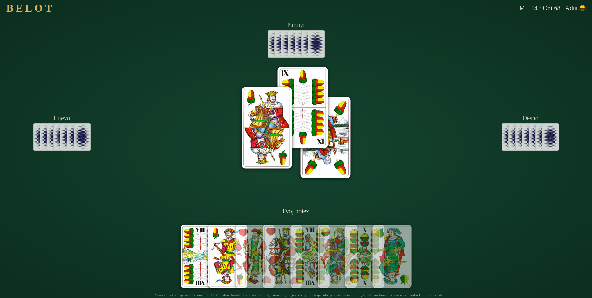

# Bela / Belot card game

## Description
Browser working version of the Belot/Bela card game.

Bela (also known as Belot or Croatian Belote) is the most popular card game in Croatia and widely played across the Balkans, including Bosnia, Serbia, Slovenia, and parts of the former Yugoslavia.  
It is a four-player partnership trick-taking game belonging to the Belote family, played with a stripped 32-card deck (7 through Ace).  
The objective is for one team to reach 1,001 points first by winning tricks and declaring specific card combinations.

## Game Setup and Dealing

Players: 4 players in 2 opposing partnerships, sitting opposite each other. 
Deck: 32 cards (7, 8, 9, 10, Jack, Queen, King, Ace in all four suits). 
Dealing: The dealer gives 6 cards to each player, leaving 2 cards face-down as a talon (reserve). 

## Determining Trump

Bidding starts clockwise from the player left of the dealer. Players may name a suit or say "dalje" (pass).
If all players pass, the dealer must choose the trump suit. 
After trump is chosen, each player picks up the 2 talon cards, resulting in 8 cards per hand. 

## Scoring and Declarations

Card Points: Ace (11), 10 (10), King (4), Queen (3), Jack (2), 9 (14 in trump, 0 otherwise), 8/7 (0).
Trump Hierarchy: In trump suits, the order is Jack > 9 > Ace > 10 > King > Queen > 8 > 7. In non-trump suits, it is Ace > 10 > King > Queen > Jack > 9 > 8 > 7.
Bela: A special declaration worth 20 points for holding both the King and Queen of the trump suit in the same player's hand.  It is declared when the first of these cards is played and always counts, regardless of other declarations.
Zvanja (Melds): Players declare sequences before play begins:
3-card sequence: 20 points.
4-card sequence: 50 points.
5+ card sequence: 100 points.
Four of a kind (e.g., four Jacks): 150–200 points depending on rank. 

## Winning the Hand

The team that chose trump must win more than half of the total points available (including card points, last trick bonus, and declarations).
If they fail, the opposing team wins all points for that hand (a result known as Pad or fallen). 
Winning all 8 tricks (Capot or Štiglja) awards a significant bonus (typically 90 points). 

## Sample Image

